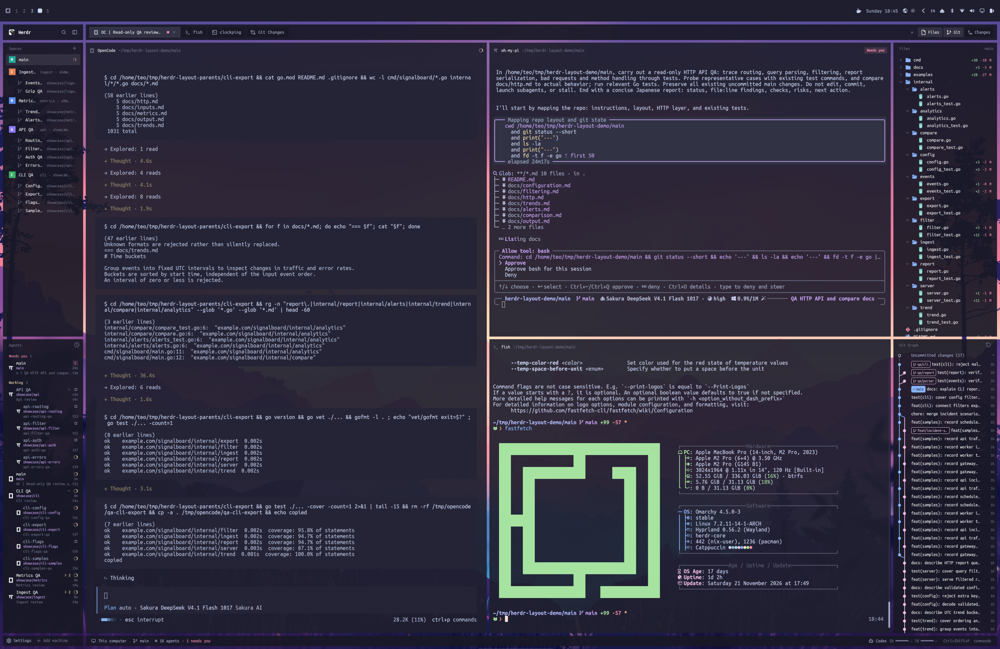

# Omarchy Catppuccin

A Catppuccin Mocha layout for Herdr app designed to fit Omarchy's Hyprland desktop, with square panes, transparent gaps, and bundled mods.

## What you see

- A 250px left sidebar (44–480px) with a 42px Herdr header, equally weighted Spaces and Agents lists, and a 28px Settings/Add machine footer. Spaces have colored initials, optional repository/branch and ahead/behind details, and attention counts. Agents show their program, location, task, branch, elapsed time, and status.
- A 42px tab bar across the work area with terminal tabs, a new-tab button, Files, Git, and Changes buttons. The active tab's terminals fill the center. Each pane has a square, always-visible 42px header with its program, folder, and status; terminals use a dark translucent `#1e1e2eeb` background.
- A right panel, hidden initially, 420px wide when shown (280–900px). Files is a folder tree with Git change marks and line counts; Git Graph shows commits, branch/tag labels, and an uncommitted-changes row. Either or both can be shown, one above the other.
- A 28px bottom bar with the current machine and branch, agent and blocked counts, Codex usage for the 5-hour and weekly windows, and the command-palette shortcut.
- No system title bar; 7px gaps, square pane edges, transparent canvas, Catppuccin Mocha chrome (`#181825eb`), lavender accent (`#cba6f7`), and Summer Ghost at 16px for terminals and UI. The included theme also sets terminal ANSI colors and status colors.

## How it behaves

- Click a space to switch to it; drag a space to reorder it within its machine, or right-click for its menu. Repository worktrees appear beneath their checkout. The sidebar toggle narrows the sidebar into a compact rail; the Agents list can unfold it again.
- Click an agent to focus its pane. The list groups agents by space or sorts them by priority, with pinned agents first; it can fold groups and show nested sub-agents. Hover an agent to pin or unpin it. Working agents have a spinning indicator; blocked agents say “Needs you”; done agents have a filled dot; idle agents have an outlined ring. Blocked spaces show an attention count.
- Click a tab to select it, double-click to rename, drag to reorder, right-click for its menu, or click its close icon to close it. The tab bar's mouse wheel switches tabs. Working tabs spin; blocked and done tabs show colored dots. A pane header likewise shows working, blocked, or done status; hover it to reveal split-right, split-down, zoom, and close controls.
- The Files and Git buttons independently toggle the right panel's two sections. Their visibility is remembered per space. Click a folder to expand it, or a file to open it in a terminal-based `nvim` dialog. Refresh Git Graph with its button; use “Load more commits…” after the first 200 commits.
- Changes opens a terminal-based Git diff dialog for the focused folder, including staged and untracked files. The plus button opens a menu for a new terminal, agent, or space. The header search opens a tab/space picker; the footer opens Settings or Add machine. The bottom-right command hint opens the palette.

## Built from

- `layouts/omarchy-catppuccin.json`: a root `row` with `titlebar: "none"`, a sidebar `column`, and a work `column`. The work area contains the tab-bar `block`, a `row` with `content: { tab: "active", pane: { ... } }` and the hidden `panel` column, then the status `block`. The pane header uses `pane-square`; the layout selects `catppuccin-mocha`, `menu-square` for the terminal menu, and Summer Ghost for both font fields.
- `themes/catppuccin-mocha.json`: transparent canvas, dark chrome, accent/status colors, and the terminal palette. Copy it into the Herdr app's `themes/` alongside the layout and mods.
- `mods/workspace-chrome-square/` draws the header and footer; `mods/spaces-square/` draws spaces, machine groups, worktrees, Git details, and attention; `mods/agents-square/` draws the grouped agent list and statuses. The latter two use `shared()`/`setShared()` for colors, widths, and sorting, plus `localStorage` for local presentation state.
- `mods/tabs-files/` draws tabs and panel buttons; its `changes-diff.sh` runs the Changes dialog. `mods/pane-square/` draws pane headers. `mods/files-square/` draws the folder tree and file viewer. `mods/git-graph/` draws commit history with `history.js`. `mods/workspace-status-square/` draws the bottom bar and Codex meter. `mods/new-menu-square/`, `mods/menu-square/`, and `mods/picker-square/` provide menus and the picker.
- Mods use Herdr's `spaces()`, `agents()`, `panes()`, `terminals()`, `focused()`, `layout()`, `theme()`, `run()`, `exec()`, overlays, and folder watching. They call commands such as `space.select`, `pane.focus`, `tab.select`, `layout.show`, and `layout.hide`. Git-backed views run `git`; the file viewer and Changes dialog start terminals with `hc`. Codex usage comes from `codexbar dashboard`.
- The layout reuses icons from Herdr's shipped `mods/workspace-chrome/`, `mods/files/`, `mods/pane/`, `mods/tabs/`, and `mods/changes/` folders; the Git Graph's icons live in this recipe's `mods/git-graph/`. No separate `keys.json` is supplied.

## Watch out

- The font is named explicitly: install Summer Ghost to see the intended typography. The file tree asks for JetBrainsMono Nerd Font for file icons. The square mods also refer to shipped Herdr mod assets, so their icons depend on those assets being present in the installed app.
- The Files button opens files with `nvim`; `hc` and `nvim` must be available on the relevant machine. The Files tree is limited to 500 entries per directory and 5,000 total. Git Graph shows 200 commits at a time; both panels need a folder, and Git Graph needs a Git repository.
- Changes needs `bash`, `fzf`, and `git` on the machine running its dialog. It uses Git's colored diff without an external formatter.
- Codex quota display needs `codexbar`; when its snapshot cannot be read, the bar shows unavailable values. Other usage providers exist in the mod but this layout requests only Codex.
- The repo includes tests and source files beyond the installed layout. Copy only `layouts/omarchy-catppuccin.json`, `themes/catppuccin-mocha.json`, and the listed `mods/` folders when installing; `RECIPE.md` and `preview.png` are for the Gallery, not the app configuration. Rename the layout and mod references and their internal asset paths if those names already exist.

## Done when

- `herdr-app check mods/<name>` succeeds for each included mod; the layout and theme load without error, and switching to `omarchy-catppuccin` and back works.
- Spaces and agents appear in the left sidebar; changing an agent's status updates its indicator, and selecting an agent focuses its pane.
- Tabs switch, rename, and reorder; Files and Git open independently and keep their visibility when switching spaces. The Files tree opens a file with `nvim`, and Git Graph shows history in a repository.
- In a Git repository, Changes shows tracked, staged, and untracked changes.
- With `codexbar` available, the status bar shows current Codex quota values.
